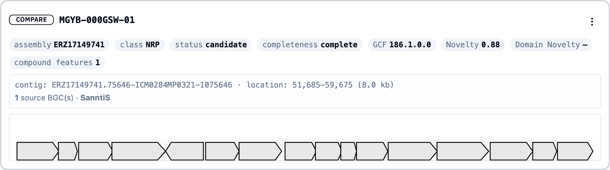

When you select an iBGC, its detail card appears on the right of the discovery platform. There are two such cards, with identical layouts:

- **Reference** (top) — the iBGC you pin with **right-click → Set as reference iBGC**. It stays put while you browse other candidates.
- **Compare** (middle) — updates every time you **left-click** an iBGC in the roster or on the Variables map.

Together they let you hold one cluster fixed and read others against it.

## What the card shows

### Header

The iBGC accession, a **Reference** / **Compare** badge, a **Type Strain** badge where applicable, and an actions menu (set as reference, find similar, add to shortlist).

### Attribute chips

A row of chips summarises the cluster:

| Chip | Meaning |
|------|---------|
| **assembly** | Parent assembly accession — links out to its source page when available. |
| **class** | The normalised [BGC class](bgc-classes.qmd). |
| **status** | `validated` (experimentally characterised reference) or `candidate`. |
| **completeness** | `complete`, or `partial` if the cluster runs off the contig edge. |
| **GCF** | The gene cluster family path (e.g. `42.7.3`). **Click it** to filter the whole discovery platform to that family and its descendants. |
| **Novelty** | Distance from the nearest validated cluster. |
| **Domain Novelty** | Fraction of domains unique within the GCF. |
| **NP class** | The confident NPClassifier pathway(s) of the predicted or curated product; `—` when there is no label, `?` when only tentative ones exist. Hover for every label; click a label to filter the discovery platform by that term. |

### Location and sources

A line gives the **contig**, the cluster's **start–end** coordinates and size, the number of **source BGC predictions** it consolidates, and the **tools** that produced them.

### Region plot

A gene-level diagram of the cluster: each arrow is a protein-coding gene (CDS). **Click any gene** to load its protein — sequence and domain annotations — into the [Protein Information panel](protein-panel.qmd) at the bottom of the discovery platform.

### NPClassifier labels

The **NP class** chip summarises what the cluster is predicted to make, in the vocabulary of the [NPClassifier](key-concepts.qmd#predicted-product-class-npclassifier) ontology. Its hover tooltip lists every label the iBGC carries, one per line:

- the **level** (pathway, superclass, or class) and the term name;
- the **score** (0–1, two decimals) the detector assigned, and `(low)` when the label is tentative rather than confident;
- `curated` when the label comes from a reference annotation (MIBiG) rather than a prediction.

Predicted labels come from **SanntiS 1.0**, which classifies each cluster it calls; validated iBGCs carry the curated labels of their MIBiG entry. Where several source predictions label the same iBGC, the labels are pooled. Clicking any label in the tooltip applies it as a [Natural product class filter](filtering.qmd).

## Using the two panels together

A typical comparison:

1. Find a promising cluster and **right-click → Set as reference iBGC**. It pins to the top.
2. **Left-click** through similar candidates (or use [Find similar iBGCs](similar-ibgc.qmd)); each loads into the Compare card.
3. Read class, GCF, novelty, size, and predicted product class against the reference.
4. Click into individual genes to confirm the domain architecture in the [protein panel](protein-panel.qmd).
5. Add the keepers to your [shortlist](shortlists.qmd).

## Related pages

- [Protein Panel](protein-panel.qmd)
- [Scores & Metrics](scores-metrics.qmd) · [BGC Classes](bgc-classes.qmd)
- [Find Similar iBGCs](similar-ibgc.qmd)
